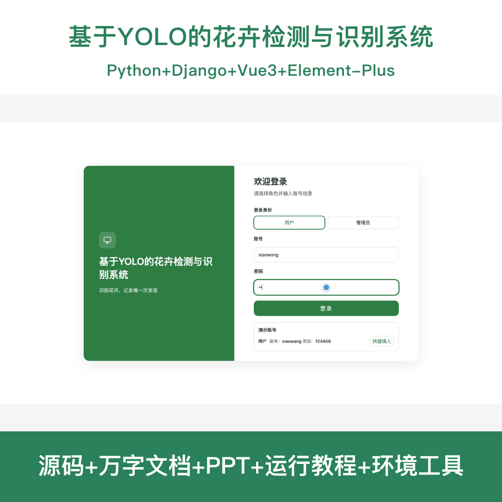
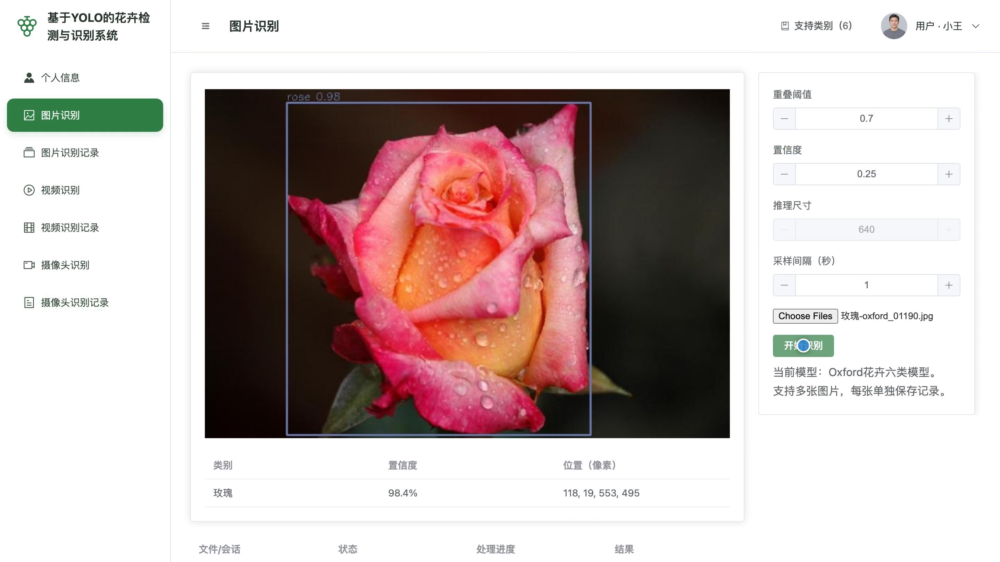
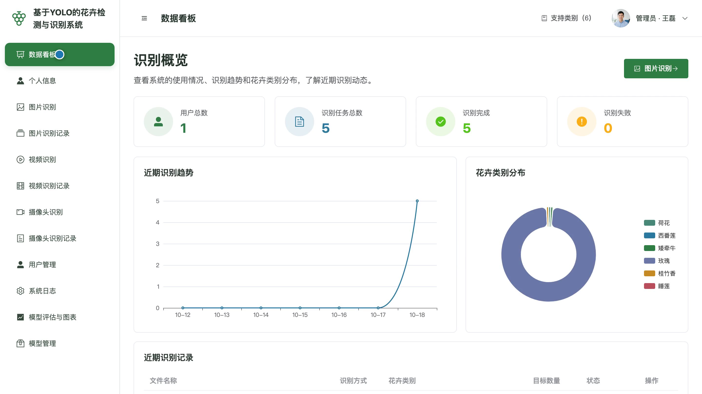
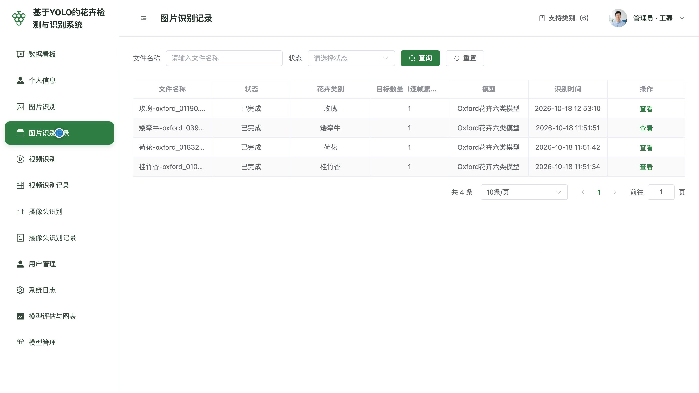
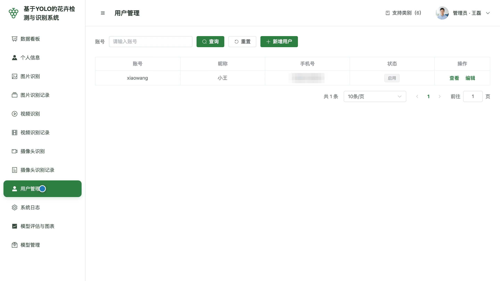
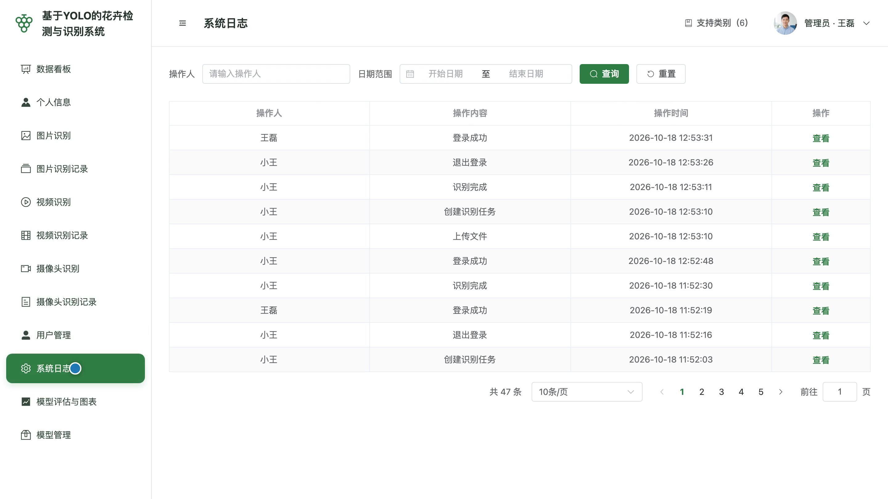
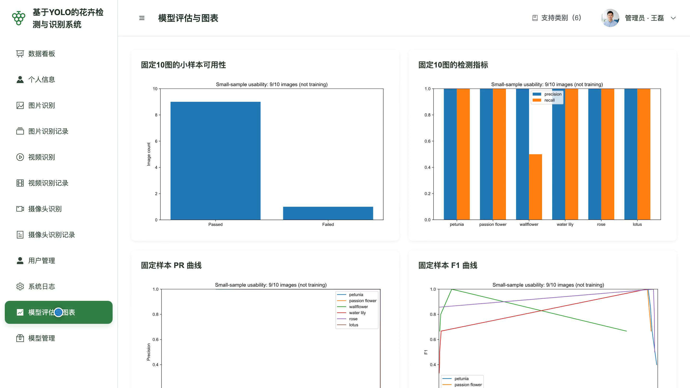
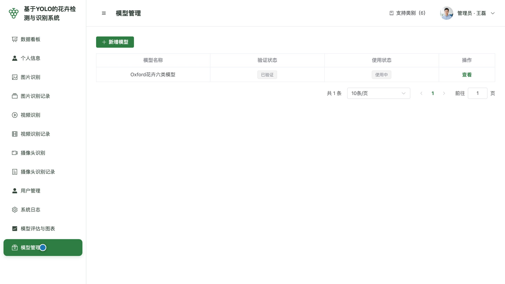

# bs174D
bs174D基于YOLO的花卉检测与识别系统源码 Python Django Vue3 前后分离
## 源码问题查看主页咨询

### 一、关键词
花卉识别、花朵检测、植物分类、花种辨识、园艺识花

### 二、作品包含
源码+数据库+全套环境和工具资源+本地部署教程

### 三、项目技术
前端技术： Html、Css、Js、Vue3.4、Element-Plus
后端技术：Python、Django、DRF、OpenCV、YOLO11

### 四、运行环境要求
开发工具：PyCharm + VSCODE

数据库：MySQL5.7+（共8张表）

数据库管理工具：Navicat10以上版本

环境配置软件： Python3.11

前端Nodejs：20.19.5

浏览器：谷歌浏览器

### 五、项目介绍
项目编号：bs174D

本系统围绕花卉检测与识别，支持六类花卉的图片单张与批量识别、视频识别及摄像头识别，展示类别、数量、置信度与标注结果。用户在管理端处理并查询本人识别任务，管理员查看全局看板、管理账号、模型及操作日志，识别记录保留当次模型和参数信息。

角色：用户、管理员

用户功能：账号登录、个人资料与密码维护、花卉图片单张与批量识别、花卉视频识别、摄像头花卉识别、本人多种识别记录查询。

管理员功能：账号登录与个人资料维护、花卉识别数据看板、用户账号维护与启停、花卉图片单张与批量识别、花卉视频与摄像头识别、全局多种识别记录查询、操作日志查询、模型登记切换与评估图表查看。

### 六、运行截图

